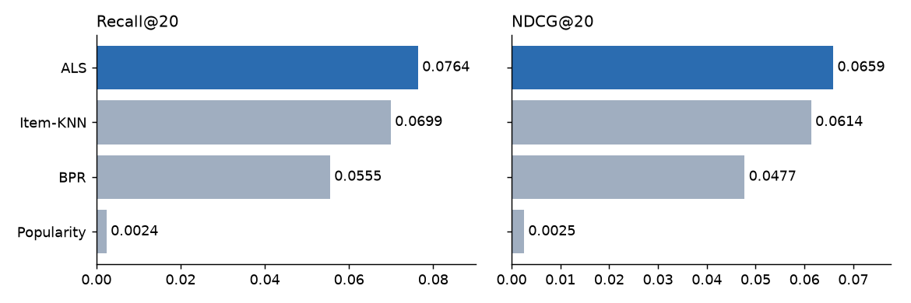
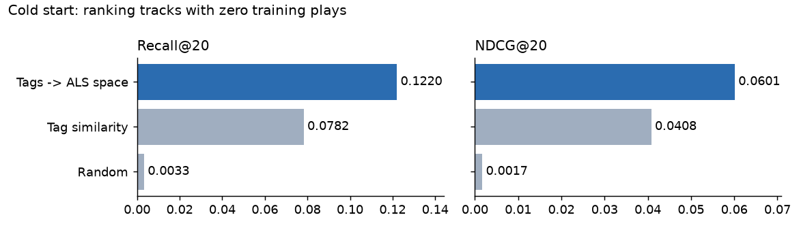
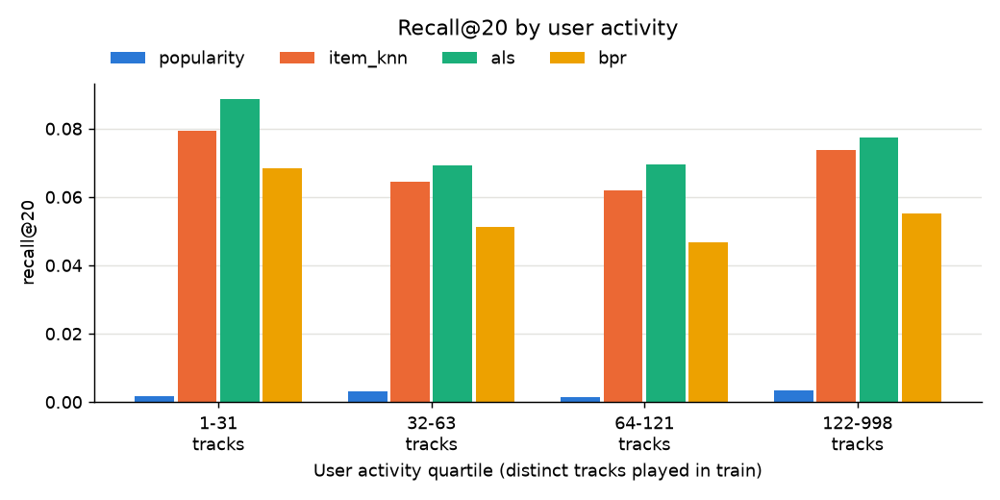
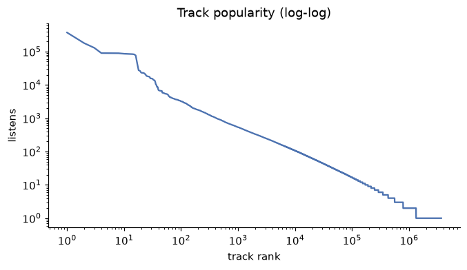

# Music Recommender

> A recommender built on open ListenBrainz listening data: tuned ALS reaches **0.066 NDCG@20, ~26x a popularity baseline**,
> and a tag-based cold-start model recovers brand-new tracks with **37x the recall of random**.

**Demo:** _(add your Streamlit Community Cloud URL here after deploying; see "Deploy" below)_

## Problem
Given a user's listening history, recommend tracks they haven't heard yet and are likely to play.

## Data
- **Source:** ListenBrainz listens (open data, CC0), from the official daily incremental dumps (`data.metabrainz.org/pub/musicbrainz/listenbrainz/incremental/`, Parquet), enriched with MusicBrainz/Last.fm tags.
- **Cleaning:** dumps include users importing years of old history, so only listens timestamped inside the dump window are kept.
- **Sample used:** listens from 11 - 25 Oct 2026 (14 days).
  17.1M listens / 40,093 users / 3.94M tracks raw -> **8.77M listens / 27,884 users / 90,885 tracks** after filtering (density 0.35%).
- **Preprocessing:** drop users/tracks with < 20 listens (iterated); confidence weighting `1 + a*log1p(plays)`.

## Method
| Model | Idea |
|---|---|
| Popularity | Most-played unheard tracks (baseline) |
| Item-KNN | Cosine similarity between tracks' listener sets |
| ALS | Implicit-feedback matrix factorization |
| BPR | Pairwise ranking loss (played > unplayed), ignores play counts |
| Content (tags) | TF-IDF tag vectors per track; user profile = average of their tracks' tags |
| Tags -> ALS | Linear map from tag vectors to ALS item factors, so tracks with no plays still get an embedding |
| Hybrid | `w * ALS + (1-w) * content` score blend |

**Evaluation:** time-based split (train on first 80% of the timeline, test on last 20%), measuring recall@20 and NDCG@20 on *new* tracks only, to avoid leakage.
Test set = listens after 22 Oct 2026 08:38 UTC, 5,000 sampled users, same users for every model.
Hyperparameters and the hybrid weight were chosen on a separate validation split, never on the test set.

## Results

### Collaborative models


| Model | Recall@20 | NDCG@20 |
|---|---|---|
| Popularity | 0.0024 | 0.0025 |
| BPR (512 factors, lr=0.05, 600 iters) | 0.0555 | 0.0477 |
| Item-KNN (K=2000, binary) | 0.0699 | 0.0614 |
| **ALS** (1024 factors, reg=10, alpha=40) | **0.0764** | **0.0659** |

ALS is **~26x popularity** and ~7% better than Item-KNN on NDCG@20 (results/results.csv).

### Cold start: recommending tracks with zero plays
10% of tracks are made "cold" (all their training plays removed). Each user ranks only the cold tracks and is scored on the cold tracks they first played in the test period.



| Model | Recall@20 | NDCG@20 |
|---|---|---|
| Random | 0.0033 | 0.0017 |
| Tag similarity (content) | 0.0782 | 0.0408 |
| **Tags -> ALS space** | **0.1220** | **0.0601** |

Projecting tags into the ALS embedding space beats plain tag similarity by 56% recall: collaborative structure
learned on warm tracks transfers to cold ones through their tags (results/cold_start.csv).

### Hybrid (ALS + content)
Blend weight 0.9 on ALS was best on validation (results/hybrid_tuning.csv).

| Model | Recall@20 | NDCG@20 |
|---|---|---|
| ALS | 0.0763 | 0.0659 |
| Content only | 0.0309 | 0.0262 |
| Hybrid (w=0.9) | 0.0763 | 0.0663 |

**Honest read:** on warm tracks the hybrid is a wash (+0.6% NDCG, equal recall, well within sampling noise). Tags add little when
there are plenty of plays; their value is cold start, where nothing else works. The blend helps the heaviest users slightly
(NDCG 0.0767 -> 0.0776) and slightly hurts the lightest on recall (results/hybrid_by_activity.csv).

### By user activity


Quartiles of distinct tracks played in train (~1,250 users each), table in results/by_activity.csv.
Recall is **roughly flat across activity levels** (ALS 0.069-0.089): light users are served about as well as heavy ones.
The ranking ALS > Item-KNN > BPR >> popularity holds in every quartile.

### Hyperparameter tuning (scripts/tune.py, results/tuning_log.csv)
The training period is split again by time (first 80% fit, last 20% validate), so tuning never sees the test period.
Tuned first on an earlier 14-day pull (106 runs), then re-checked with 80 runs on the final 11-25 Oct window.
- **ALS factors mattered most:** on the first window validation NDCG@20 rose 0.044 (64) -> 0.054 (256) -> 0.059 (512) -> 0.061 (1024).
  With ~90k tracks and a very diverse catalogue, low-rank models underfit.
- **Confidence weight alpha** peaked around 40 for ALS; **regularization barely mattered** (0.01 to 10 within 0.0004 at 256 factors).
- **Item-KNN prefers binary input** (alpha=0) and many neighbours: repeat plays mostly add noise for item similarity.
- **BPR underperformed ALS** at every setting tried and was ~10x slower to train.
- Tuning gave ALS about **+38% NDCG** over defaults (measured on the first window: 0.0500 -> 0.0691).

### EDA highlights (notebooks/01_eda.ipynb)


_EDA numbers are from the first 14-day pull (30 Sep - 16 Oct); the shape is the same on the final window._
- Heavy-tailed users: median 172 listens/user over ~2 weeks; the top 1% of users produce 19.3% of listens.
- Extreme popularity skew: the top 0.1% of tracks get 27.4% of listens; 63.9% of tracks are played only once.
- The head is a single fandom: BTS-related tracks are 16.9% of all listens but come from only ~4% of users,
  which is why the popularity baseline is so weak here (it recommends BTS to everyone).

## Analysis / what I learned
- **Popularity is a weak baseline here** because the head of the distribution is one fandom (BTS, 16.9% of listens
  from ~4% of users). This is unlike MovieLens-style data, where popularity is usually hard to beat.
- **Capacity, not regularization, was the bottleneck:** more latent factors drove most of the tuning gain.
- **Simple wins:** well-tuned Item-KNN is within 7% of ALS; BPR's pairwise loss did not pay off at 10x the training cost.
- **Content features earn their keep only in cold start** (0.12 recall@20 vs 0.003 random); blending them into warm recommendations barely moved the metric.
- **User activity matters less than expected:** users with only 1-30 distinct tracks get recall comparable to heavy users.
- **Limitations:** a 2-week window; offline metrics only (users can't play what they were never shown, so recall on new
  tracks understates real quality); the demo is item-to-item (no personalised user vectors); tags come from
  MusicBrainz/Last.fm, so obscure tracks can be untagged.

## Deploy (Streamlit Community Cloud)
The repo ships a slim copy of the model in `app/data/` (int8-quantized ALS embeddings, ~98 MB in two shards; regenerate with
`python scripts/make_deploy_artifacts.py`) and `app/requirements.txt` (no `implicit`, which the app doesn't need).
1. Push this folder to a public GitHub repo.
2. Go to share.streamlit.io -> New app -> pick the repo, branch `main`, main file `app/streamlit_app.py`.
3. Paste the resulting URL at the top of this README.

## Run it
```bash
python -m venv .venv && source .venv/bin/activate   # Windows: py -3.12 -m venv .venv; .venv\Scripts\activate
pip install -r requirements.txt

# 1. Try the pipeline immediately on fake data
python scripts/make_synthetic_data.py
python scripts/run_experiment.py --save-artifacts

# 2. Real data: download the last 14 days of ListenBrainz dumps (~2.4 GB, no account needed)
python scripts/pull_from_dumps.py --days 14
python scripts/run_experiment.py --save-artifacts
#    (alternative, if a BigQuery table is available: edit sql/pull_sample.sql, then
#     python scripts/pull_from_bigquery.py --project YOUR_GCP_PROJECT)

# Hyperparameter search on a validation split (appends to results/tuning_log.csv)
python scripts/tune.py
python scripts/tune.py --models als --grid "{\"factors\": [512, 1024], \"alpha\": [40]}"

# 3. Extension experiments, charts, demo app
python scripts/pull_tags.py
python scripts/cold_start.py
python scripts/hybrid.py
python scripts/make_figures.py
streamlit run app/streamlit_app.py

# Tests
pytest
```

## Project structure
```
src/recsys/   data.py (load/filter/split/matrix) | metrics.py | models.py | content.py (tags, cold start, hybrid)
scripts/      pull_from_dumps.py | pull_tags.py | run_experiment.py | tune.py | cold_start.py | hybrid.py
              make_figures.py | make_deploy_artifacts.py | pull_from_bigquery.py | make_synthetic_data.py
notebooks/    01_eda.ipynb
sql/          pull_sample.sql
app/          streamlit_app.py | requirements.txt | data/ (deploy artifacts)
tests/        test_metrics.py | test_content.py
```

## Next steps
LightFM models, FAISS retrieval, diversity/novelty metrics, online (A/B-style) evaluation.
